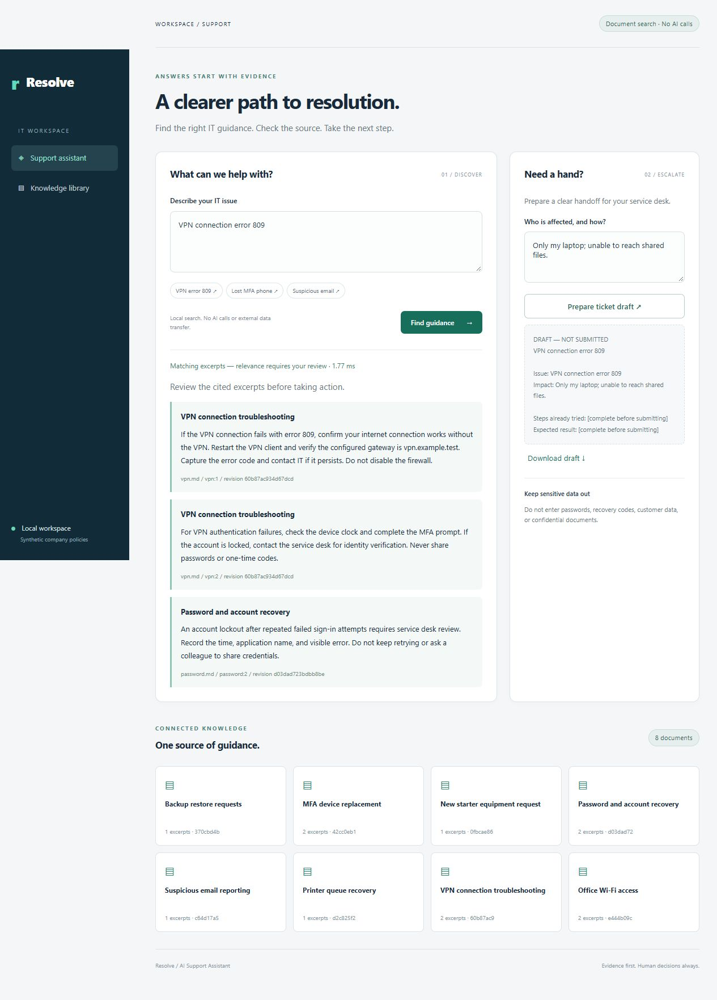

# Resolve — AI Support Assistant

[](https://github.com/ThanhVu90/-ai-support-assistant/actions/workflows/ci.yml)

A Python support workspace that retrieves IT runbooks, exposes verifiable source excerpts, and prepares ticket drafts for human review. It runs locally without API credentials; an optional OpenAI adapter selects evidence using structured output.



## The problem

Support teams repeatedly answer questions about VPN access, MFA recovery, and account issues. A fluent but unsupported answer can be worse than no answer. Resolve keeps source text, document IDs, and content revisions visible, rejects fabricated model citations, and never executes remediation or submits tickets.

## Try it in five minutes

Requires Python 3.12+ with SQLite FTS5. Run these commands inside the repository:

```powershell
python -m venv .venv
.\.venv\Scripts\Activate.ps1
python -m pip install -r requirements.txt
python -m uvicorn assistant.app:create_app --factory --host 127.0.0.1 --port 5081
```

On macOS/Linux activate with `source .venv/bin/activate`. Open http://127.0.0.1:5081/ and try **VPN error 809**, **Lost MFA phone**, then an unrelated question such as **quantum cosmology theorem**. Add an impact description and download a ticket draft. API documentation is at `/docs`.

All eight included documents are **synthetic example policies**, not instructions for a real organization. The default mode is labeled **Document search · No AI calls**. It returns lexical matches for review, not a generated answer or a semantic answerability judgment.

## Optional AI evidence selection

Set `OPENAI_API_KEY` securely in your local environment and set `OPENAI_MODEL` to a model available to your account that supports Responses API structured outputs; restart the server. No model or API key is bundled. API usage may incur charges.

AI mode sends the question and retrieved excerpts to OpenAI. The model can select up to three exact quotes or abstain. The server validates every selected ID and quote against the retrieved documents. It does **not** display free-form model instructions. Exact provenance does not prove semantic correctness or eliminate prompt injection; a person still reviews relevance and safety.

No live model call was performed for this release. Provider tests use simulated HTTP responses. See [verification](docs/VERIFICATION.md).

## Engineering decisions

| Concern | Implementation |
| --- | --- |
| Retrieval | SQLite FTS5 + BM25, title weighting, bounded parameterized queries |
| Ingestion | Markdown paragraph boundaries, deterministic IDs, content revisions, atomic replace |
| Grounding | Strict output model, retrieved-ID allowlist, exact quote validation, duplicate rejection |
| Reliability | Provider timeout, explicit 502/503/429 responses, no silent AI-to-search fallback |
| Cost control | 20 queries/minute, two concurrent requests, bounded input and output |
| Privacy | No query/draft database; API key server-side; provider `store=false`; no external page assets |
| Frontend | Responsive HTML/CSS/JavaScript; text-only rendering of untrusted content |
| Delivery | Tests and evaluation in CI on Windows and Ubuntu |

## Reproduce verification

```sh
python -m pytest -q
python -m evals.run
python -m ruff check .
python -m ruff format --check .
```

The authored regression set has 12 answerable retrieval cases and 3 unrelated no-match cases. It is intentionally small and is not an independent benchmark or evidence of live LLM accuracy. Per-case results are checked in at [evals/report.json](evals/report.json).

## Project map

- `assistant/retrieval.py`: indexing, revisions, FTS query construction.
- `assistant/provider.py`: optional Responses adapter and output schema.
- `assistant/service.py`: orchestration and provenance checks.
- `assistant/app.py`, `assistant/limits.py`: API and request boundaries.
- `tests/`: database, API, provider failure, validation, and evaluation regressions.
- `knowledge/`: synthetic English documents; replace and restart to rebuild the index.
- [Architecture and tradeoffs](docs/ARCHITECTURE.md) · [Verification record](docs/VERIFICATION.md)

## Scope and limitations

This is a **single-user localhost portfolio application**, not a production helpdesk deployment. There is no login, tenant isolation, shared rate-limit store, semantic embedding search, or multilingual benchmark. Do not expose it on a public interface or load confidential policies. A production service needs authentication/authorization, document-level access checks, TLS, operational monitoring, distributed quotas, data-retention review, and independent relevance/safety evaluation. The custom client header and Host/Origin checks are browser boundaries, not authentication.

Documents are edited on disk, not uploaded over an unauthenticated API. Ticket drafts contain the user's issue and impact; they are not sent to the C# service desk. `store=false` is an API storage option, not a blanket claim of zero provider retention.

Developed with AI assistance. No employment history, customer deployments, or production usage is claimed.
