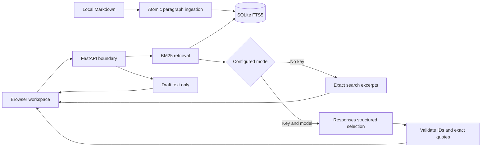

# Architecture and design tradeoffs

## Boundary design

The API layer owns HTTP validation and throttling. The service owns evidence acceptance. The repository owns retrieval and atomic ingestion. The provider owns the external HTTP protocol. Tests can replace the provider without mocking the database or the service's citation validator.

Startup reads sorted `.md` files and validates all content before replacing the index in one transaction. A document SHA-256 prefix records the content version; chunk IDs identify paragraph position and are paired with that revision, because inserting a paragraph can renumber IDs. Deleted files disappear on the next rebuild. SQLite connections explicitly close after commit/rollback to avoid Windows file locks.

FTS5 is adequate for a small local corpus and requires no external vector service. Queries are normalized, stop words removed, and terms quoted before binding to the FTS expression. BM25 ranks candidates with extra title weight. Search mode does not label its top match as a confident answer. Synonyms, negation, multilingual queries and cross-document reasoning remain known weaknesses.

## Evidence selection

The optional provider receives an instruction plus JSON-encoded question/documents in the input field. Neither document content nor questions become system instructions. The output schema allows only a boolean and evidence selections. An affirmative result must have at least one valid excerpt. Unknown IDs, altered quotes, duplicates and inconsistent abstentions fail closed.

A quotation can still be irrelevant, misleading out of context, or itself contain hostile text. Provenance validation is not entailment verification. Rendering uses `textContent`, so returned markup cannot become executable HTML. No shell, browser, email or ticket-submission tools are exposed to the model.

The adapter follows the official [Structured Outputs documentation](https://developers.openai.com/api/docs/guides/structured-outputs): `text.format` with a strict JSON schema. HTTP error, timeout, refusal/incomplete response and malformed output all yield a sanitized error. There is no automatic retry, avoiding duplicated cost for uncertain failures. No live-provider quality claim is made.

## Operational scope

Use one Uvicorn process bound to loopback. The in-memory budget allows 20 requests per rolling minute and at most two concurrent queries; it is not shared between worker processes. Inputs are bounded to 8 KiB at the ASGI boundary and the question to 1,000 characters. Provider timeout is 20 seconds and output budget 2,000 tokens. This is not a monetary spending cap.

The application persists only the index, not conversation or drafts. Requests travel from browser to the local server. AI mode additionally transmits question and retrieved text to OpenAI; the UI shows this mode. Access logs contain paths, not request bodies. Browser Host and Origin checks reduce cross-site access, but do not authenticate local processes. A public deployment would require a different security architecture.

## Next engineering increments

1. Human-labeled held-out corpus, adversarial relevance cases, and live-model evaluation with an approved budget.
2. Document ACLs before retrieval, then authenticated multi-user deployment.
3. Hybrid retrieval only after measuring failures of this lexical baseline.
4. Explicitly approved service-desk integration with idempotency and audit history.
